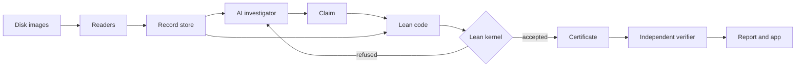

# CONAN-F

**An AI forensic investigator. Lean 4 checks every finding.**

CONAN-F (*CONsistent ANalysis in Forensics*) is a tool for digital forensic examination.
It reads disk images and makes a store of records. An AI investigator searches the records
and proposes findings. A checker converts each finding to Lean 4 code. The Lean kernel
accepts a finding only when the cited records prove it. The report shows only accepted findings.

## Why

An AI investigator can state facts that the evidence does not show. A court cannot use a
finding that nobody can check. In CONAN-F, the AI cannot write a proof. It can only propose
a claim. A fixed program converts the claim to Lean code, and the Lean kernel checks it. Each
accepted finding has a certificate that a second program checks again. Each finding links to
its records, its source on the disk image, and its proof.

## Open the app

```sh
git clone https://github.com/pauljiang03/conan && cd conan && ./install.sh
```

On a Mac, this command adds **Conan** to your Applications folder and opens it. On Linux, it
opens the same window; to open it again, run `.venv/bin/conan`. You need Python 3.9 or newer.
After `git pull`, run `./install.sh` again.

The app opens on two saved cases from the public NIST CFReDS datasets:

| Case | Evidence | Questions | Accepted findings |
|---|---|---:|---:|
| [Data Leakage](https://cfreds-archive.nist.gov/data_leakage_case/data-leakage-case.html) | One Windows 7 PC, two USB drives, one CD | [60](eval/benchmark_nist_questions.json) | 473 |
| [Hacking Case](https://cfreds-archive.nist.gov/Hacking_Case.html) | One Windows XP laptop | [31](eval/hacking_case/questions.json) | 147 |

- **Summary**: what happened, in date order, then the main facts by topic.
- **Timeline**: the cited records that have a source time, on one time axis.
- **Proof graph**: each finding back to its source: disk image, artifact, record, Lean proof.
- **Findings**: each accepted finding with its records, source details and Lean proof.
- **Report**: an examination report to print or save as PDF.

To start a new investigation, select **New investigation**. Select the evidence, write the
questions, and select the AI service: your Claude Code login, or your Anthropic API key
(Python 3.11 or newer). The app keeps the API key in `~/.config/conan-f`, readable only by
your user, and never writes it to a run folder or a log.

## Results

Each investigation had a 15-minute budget. A fixed scorer compared the answers with the
expected answers. It does not use an AI judge, and the investigator never sees the expected answers.

| Case | Fully correct | Partial | Unanswered | Incorrect | Answer fields matched |
|---|---:|---:|---:|---:|---:|
| Hacking Case | 11/31 (35.5%) | 0 | 20 | 0 | 13/52 (25%) |
| Data Leakage | 6/46 (13.0%) | 10 | 30 | 0 | 306/1,627 (18.8%) |

No submitted answer was incorrect. Data Leakage has 60 questions; the expected answers can
score 46 of them.

## How it works



1. **Read.** The readers read the disk images. They make records with values, times, time
   meanings and source details.
2. **Investigate.** The AI investigator searches the records with a small set of tools. It has
   no shell and no file access.
3. **Check.** The checker converts each claim to Lean code. The Lean kernel accepts or refuses
   it. A refusal tells the investigator which evidence is missing.
4. **Verify.** The verifier makes each proof again from the records and runs the kernel again.
   A second proof checker, con-leche, checks the proofs separately.
5. **Report.** Each accepted finding has a fixed sentence. Examiner opinions stay separate.

A proof shows that a claim follows from the cited records and the rules in
[`lean/ChainOfProof`](lean/ChainOfProof). It does not show that a reader read the disk image
correctly. It does not identify the person who used a device, or why. The app marks findings
that use a heuristic rule.

## Use the command line

`./install.sh` also installs the `conan` command in `.venv`. Run `source .venv/bin/activate` first.

```sh
conan investigate --name dev/my-case --images /path/images --exhibits exhibits.json \
  --question "Which external devices were connected?" --minutes 10
conan report --run runs/dev/my-case/run.json --format html --out report.html
conan verify --run runs/dev/my-case/run.json --facts /path/facts.json
```

`exhibits.json` names each image and its role (`pc`, `removable` or `optical`), for example
`{"laptop.E01": {"exhibit": "PC1", "role": "pc"}}`. CONAN-F reads E01 sets, raw images and
optical images. `conan investigate` prints the path of the record store (`facts.json`); use it
with `conan verify`. The disk images stay on your computer. The AI service receives only the
questions and the tool results.

| Command | Use |
|---|---|
| `conan ingest` | Extract records only. Do not start the AI investigator. |
| `conan plan`, `conan resume` | Continue an investigation in a new run. |
| `conan serve`, `conan desktop` | Open the app in a browser or a window. |
| `python -m verifier.package build` | Make a package that another examiner can verify without the disk images. |

## Develop

Install the Lean toolchain named in [`lean/lean-toolchain`](lean/lean-toolchain). Then:

```sh
cd lean && lake build && cd ..
.venv/bin/python -m pip install 'dissect>=3.20'
.venv/bin/python -m unittest discover -s tests -t .
```

Disk images are not in Git. To get them, run `scripts/fetch_data.sh --pc` (Data Leakage) or
`python scripts/fetch_hacking_case.py` (Hacking Case).

To score answers, run `python -m eval.baseline`.

## Data

The disk images come from the NIST Computer Forensic Reference Data Sets (CFReDS). They are
public, staged cases.
