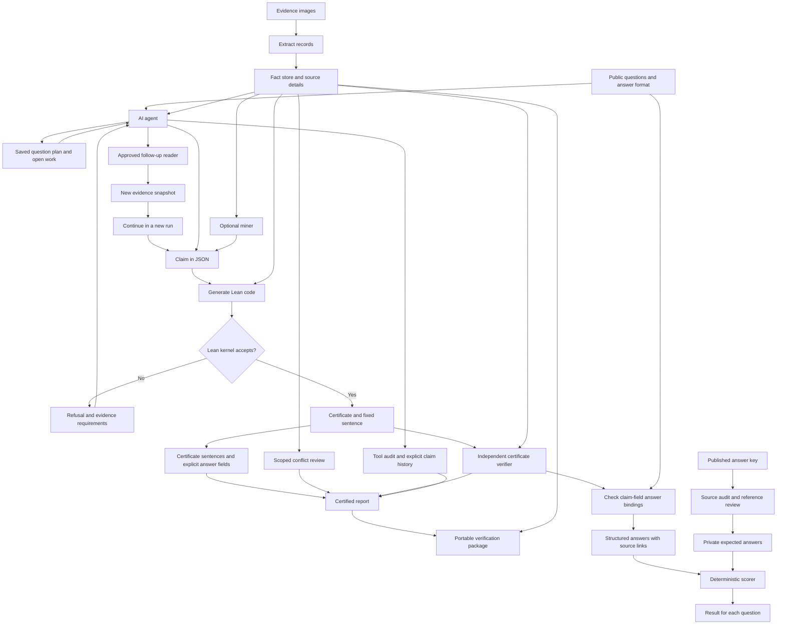

# CONAN-F

**CONsistent ANalysis in Forensics.** Formerly Chain of Proof.

CONAN-F produces forensic findings with Lean proofs.
The AI investigator searches records and proposes claims.
An optional miner supplies a baseline with preset search rules.
The Lean kernel verifies the formal claim against extracted records.
The report uses fixed sentences from accepted claims.

The project uses the [NIST CFReDS Data Leakage Case](https://cfreds-archive.nist.gov/data_leakage_case/data-leakage-case.html).
The case has [60 questions](eval/QUESTIONS.md), one PC image, and three removable media images.
The code also accepts other cases through explicit case profiles and evidence manifests.

## Current state

The [latest development comparison](comparison/ablation/RESULTS_SOL61_20261115.md) uses explicit claim fields as answers.
Both investigators received the same 335,509 extracted records and all 60 public questions.
They used the requested Sol 6.1 model, with one run per mode and a 15-minute limit each.
The scorer uses fixed rules. It does not use an LLM judge.

| Mode | Complete answers | Partial | Unanswered | Incorrect |
|---|---:|---:|---:|---:|
| A: no Lean feedback | 8/46 (17.4%) | 20 | 16 | 2 |
| B: check A's exact claims afterwards | 8/46 (17.4%) | 20 | 16 | 2 |
| C: Lean feedback during investigation | 7/46 (15.2%) | 21 | 15 | 3 |

The other 14 questions require reference-review decisions. They remain visible and unresolved.
This pair showed no answer-accuracy gain from Lean feedback.
All 63 B certificates and all 96 C certificates passed independent verification.
Valid claims can still be placed in the wrong answer field or fail to answer the full question.
The test did not demonstrate rejection of a semantically false claim: B accepted all proposals,
and C's one refusal was a malformed claim.

A public-schema export bug dropped some attempted fields. Shared-field `anyOf` support was added after this test.
The saved scores were not changed, and the fix has no new accuracy score.

The measured code is frozen at `c2b9753`. The test used a controlled Sol tool bridge;
it does not validate the product's native model backend. This is one development pair, not an unseen-case benchmark.
The earlier literal-answer pilot used a different answer channel and is not a direct comparison.

A second-case operational test also passed. All 34 C certificates and 10 B certificates reverified.
That case has no accuracy key. Its field counts are not accuracy scores.
The [saved demonstration report](runs/current/run.json) remains available, but is not the latest AI test.

The [60-question Mulder package](comparison/mulder/README.md) and [original 20-item package](comparison/mulder-original20/README.md) are prepared and unrun.
The full A/B/C/D comparison and native provider validation remain unfinished.

## Investigation CLI and reports

The CLI is the primary interface. Give it extracted facts or supported evidence images, public case context, and your questions.
Install this checkout with `pip install -e .`, then run:

```sh
cop investigate --name dev/my-case --facts /path/facts.json \
  --title "Removable media review" \
  --question "Which removable devices were connected?" \
  --question "Which files were opened from those devices?" \
  --backend claude-code --model opus --minutes 10
cop report --run runs/dev/my-case/run.json --format html \
  --out runs/dev/my-case/exported-report.html
cop verify --run runs/dev/my-case/run.json --facts /path/facts.json
```

Use `python -m app.cli` in place of `cop` when the console command is unavailable.
New app investigations save `report.html`, `report.md`, and `run.json` in their run directory.
The `report` command writes a new copy and refuses to overwrite an existing file.
Press Ctrl+C to stop an investigation and retain its partial work.
Each finding links to its records and proof. Refused claims show the unmet conditions when known.
AI judgments remain separate from checked findings.

An optional local browser interface uses the same runner:

```sh
cop serve
```

Use it to open saved reports, start an investigation, inspect completed tool calls, or stop a run.
The browser interface includes a marked synthetic example. It is not a benchmark result.

The same workbench runs as a desktop application in its own window:

```sh
.venv/bin/python -m pip install -e '.[desktop]'    # once: adds pywebview
cop desktop
python -m app.desktop --make-app ~/Applications    # macOS: a double-clickable CONAN-F.app
```

The window is the operating system's own web view, so no browser engine is bundled.
The front end is plain HTML, CSS and JavaScript with no framework and no graph library.
`--make-app` writes a small launcher for this checkout; it is not a redistributable installer.

The workbench has six views of a case:

- **Proof graph** draws each finding back to its source, left to right: disk image, source artifact,
  extracted record, finding checked by Lean, and any interpretation that is not certified.
  Select a node to trace its lineage; double-click a finding to see the findings that share its records.
  Replay steps through the findings in the order the audit log recorded them, or bundle order without one.
  The graph draws forty findings at a time; filter by device, file, path or ID.
- **Findings**, **Not established**, **Activity** and **Coverage** list the same run as tables.
- **Report** builds an examiner's report. Mark findings with their checkbox in the Findings table,
  choose the sections and appendices, add a case reference and examiner, then print it or save it as PDF.
  A report of marked findings states on its first page that it is a selection and what it leaves out.
  Cover details are printed as entered and labelled as not part of the stored run.

The inspector on the right shows the selected item's records, provenance and Lean proof.
Marks and cover details are remembered in the window's own storage as a convenience; they are not case records.
Export in the title bar downloads the complete report as HTML or Markdown, or the run bundle as JSON.
The app prints through the system print panel; it does not include a separate PDF generator.

The current release runs from an editable repository checkout with the Lean project installed.
The CLI can extract supported images before it starts the investigator. The browser start form still takes extracted facts.
The local app does not assign benchmark scores. Model access uses the local CLI login or API environment.

## Evidence intake and continued work

Use an explicit image manifest for each new case. For example, save this as `exhibits.json`:

```json
{"laptop.E01": {"exhibit": "PC1", "role": "pc"}}
```

The supported roles are `pc`, `removable`, and `optical`.
Intake accepts numeric E01–E99 sets, raw `.dd`, `.raw`, `.img`, and `.bin` images, and `.iso` or `.udf` images.
A recognized extension does not guarantee that every file system or artifact is supported.
Use the readers that apply to the image and its file system.
A missing image or an invalid role stops intake. Parser failures remain in the extraction health file.

```sh
cop investigate --name dev/new-case --images /path/images --exhibits exhibits.json \
  --question "Which external devices were connected?" --minutes 10
```

Use `cop ingest --images /path/images --exhibits exhibits.json --out /path/new-snapshot`
to extract records without an AI run.
Each snapshot records its image hashes, facts hash, reader selection, and parser failures.
The images are read locally. The investigator backend receives the public prompt and selected tool results.

The investigator saves work for each question in `investigation.json`.
It records searches, finding links, unresolved fields, and next actions.
`case-answers.json` groups exact certificate sentences by question for any case.
The `answer` tool can also put specific claim fields into the public answer format.
It saves the claim, field, source record, and question path for each value.
These values appear in `projected-answers.json` and the HTML and Markdown reports.
A missing field does not remove other supported fields. Conflicting bindings are shown as unresolved.
Use `--adapter claims` with explicit public questions and a private reference to score this export.
The evaluator checks the certificates again before it scores the answers.
A question can have findings and still have missing answers.
Work status does not establish answer accuracy or completeness.
The benchmark submission remains a separate `answers.json` file.

The `inventory_page` tool reads large record lists in pages and saves the next position.
Its cursor is bound to the selected evidence and filters. Reaching the last page does not prove that the image has no other evidence.
The question plan shows unfinished pages and missing required answer fields.
The investigator is instructed to review these items before it finishes, within its existing time limit.
Count claims can cite up to 2,048 records. The Lean kernel still checks the count.
Large distinct-value counts can reach the time limit; a resource failure is not a false-count finding.

```sh
cop plan --run runs/dev/new-case
cop resume --run runs/dev/new-case --name dev/new-case-2 --minutes 10 \
  --question "What evidence links those devices to the opened files?"
```

A continuation creates a new run. It does not change the previous report.
With identical facts, it checks prior accepted claims again and restores question links.
With new facts, use `--facts /path/new-snapshot/facts.json`.
Old work notes remain context. Old record IDs and certificates do not transfer to new facts.
This resumes saved tasks; it does not restore a provider's hidden reasoning.

The `evidence_needs` tool lists approved readers for the configured images.
The `collect` tool can run a reader that has not yet run for that exhibit.
It writes a new full snapshot and retains the current snapshot.
It preserves source observations and recomputes derived tags from the combined records.
Use `--readers windows,system` for a limited initial PC intake when later collection is useful.
One successful collection is allowed per run. The next run can collect another reader.
Add `--follow-up-stages 1` to continue automatically on collected evidence once.
Each additional stage has its own `--minutes` limit. The default is no automatic extra stage.
For a manual continuation, also supply the new snapshot's `--intake-config` to permit further collection.

The final report includes a review of recognized identity ambiguities and scoped record conflicts.
Each diagnostic shows the records and the condition that requires review.
The review preserves timestamp uncertainty and does not choose which source is true.
A clean review does not establish that all evidence is consistent. Truncated reviews are marked.

## Pipeline



The public questions go to the investigator.
The expected answers go only to the scorer.
An optional appendix can contain AI judgments.
Those judgments have no Lean certificate.

1. The extractor reads the evidence images.
   It records values, timestamps, uncertainty, and source details.
   It also records parser failures.
2. The fact store assigns each record an identifier.
   It stores text separately from the numeric fields used by Lean.
3. The AI agent searches the fact store through restricted tools.
   The optional miner uses preset rules to produce candidate claims.
4. The checker converts each candidate claim into Lean code.
   The agent cannot supply its own Lean proof.
5. The Lean kernel accepts or rejects the claim for the cited records.
   An accepted claim receives a certificate and a sentence from a fixed template.
6. The independent verifier reads the fact store again.
   It compares copied fields, source details, hashes, sentences, and rule labels.
   It also regenerates the proof and runs the Lean kernel again.
7. The report contains the accepted sentences.
   Explicit claim-field bindings put supported values into the public answer format.
   Each value retains its source links.
   Question relevance and complete answers are not proved by this step.
8. The scorer compares these answers with the private reference.
   It applies declared rules for strings, lists, paths, and timestamps.
   It does not use an LLM judge.

## Proof scope

A Lean proof establishes that a formal claim follows from the supplied records and rule definitions.
It does not establish that a parser read the image correctly.
It does not prove the meaning of arbitrary English.
It does not prove that the answer key is correct.

A false positive is a reported assertion that the evidence does not support.
The project does not claim zero false positives for the complete system.
The certificate verifier and the false-claim tests cover specific failure modes.
Parsers, source interpretation, sentence templates, and answer adapters still require review.

| Component | What it establishes |
|---|---|
| Lean kernel | The formal claim holds for the supplied facts. |
| Certificate verifier | The certificate agrees with the fact store and the current proof rules. |
| Source audit | Source hashes and declared literal text agree with the saved answer document. |
| Answer scorer | Submitted values meet the declared answer contract. |
| Human review | The source interpretation and the evaluation contract are appropriate. |

A certificate can include a heuristic rule.
Its strength label identifies this dependency.
A proof of that rule's conditions does not make the heuristic certain.

## Inspect an investigation

Each finding links to all its cited records and its proof in the report.
The record view shows extracted values, timestamps, uncertainty, and available source details.
It does not invent a source offset when the reader did not provide one.

Future investigator runs record each completed evidence-tool call in `audit.jsonl`.
The log includes arguments, results, times, durations, and hashes.
Its integrity check can detect changes relative to a retained hash.
It does not authenticate the author. An interrupted call can be absent.
The run manifest binds the supplied facts, public prompt, software, and requested model.
An unobserved model revision remains unknown.

Refused claims can include a diagnostic statement of what is still required.
For example, the checker can identify a missing record, different device identities,
insufficient timestamp precision, or an unsupported claim form.
These statements are not findings or promises that supporting evidence exists.
If the records contradict the proposed relationship, the diagnostic says so.

An investigator can mark a changed claim with the earlier proposal ID in `revises`.
The new claim receives a new check. The history records this explicit link.
It does not infer corrections from similar wording.
Coverage separates extracted, explicitly inspected, and cited records from accepted findings.
Answer presence is separate from answer accuracy. Missing measurements remain unknown.

Create a portable directory with the report, complete fact store, certificates, and available logs.
This package supports verification. Use the original run directory for continuation.

```sh
.venv/bin/python -m verifier.package build \
  --run runs/current/run.json --facts evidence/case_facts.json \
  --out /path/new-verification-package
.venv/bin/python -m verifier.package verify --bundle /path/new-verification-package
```

The package verifier checks file hashes and regenerates proofs from the copied facts.
Keep its manifest hash separately if you need to detect replacement of the whole package.
The original disk images and private answer key are not included.
Old runs can lack audit or model information; packaging does not reconstruct that history.

## Formal claims

The intermediate representation uses five operations.
Named forensic rules combine these operations.
See the [rule definitions](lean/ChainOfProof/Rules.md) and [Lean theorems](lean/ChainOfProof/Theorems.lean).

| Operation | Meaning |
|---|---|
| `is` | A record has a specified type. |
| `val` | A record field has a specified value. |
| `link` | Two record fields contain the same identifier. |
| `before` | One timestamp precedes another beyond their combined uncertainty. |
| `both` | Both claims hold. |

For example, a USB mount claim must use the same device identifier in both cited records.
A matching display label is insufficient for device identity.
Count claims refer to all matching records in the supplied fact store.
They do not establish that the extractor found every real event.

## Evaluation

A question can require a single value, a table, or several related answers.
Each required table field contributes to that question's result.
Full credit requires all required answers under the declared comparison rules.

| Result | Meaning |
|---|---|
| `FOUND` | All required values match, with no extra values outside the contract. |
| `PARTIAL` | Some required values match. |
| `MISSED` | The system supplies no answer. |
| `INCORRECT` | The system supplies an answer, but no required value matches. |
| `UNEVALUABLE` | The reference cannot yet determine the full result. |

All 60 questions remain visible in the results.
The scorer reports the number of questions with complete answers.
It also reports questions that require reference review.
A difference from the answer contract is not sufficient evidence of a forensic false positive.
For example, a valid additional record can be outside a reference list.

The current case is a development case.
Developers have read its answer key.
A future test on unseen evidence must use a separate frozen reference.
See the [evaluation procedure](eval/EVALUATION.md) and [reference review](eval/BENCHMARK_REFERENCE.md).

## Local setup

Install Python and the Lean toolchain named in [lean-toolchain](lean/lean-toolchain).
The core package requires Python 3.9 or later.
The optional API backend requires Python 3.11 or later.

Create the Python environment:

```sh
python3 -m venv .venv
.venv/bin/python -m pip install --upgrade pip
.venv/bin/python -m pip install -e .
```

The upgrade is required where Python ships an old pip, such as the macOS system Python 3.9.
Older pip versions cannot install this project in editable mode.

Build the Lean project from the `lean` directory:

```sh
cd lean
lake build
```

Return to the repository root.
The full regression suite requires the Dissect readers.
The optional API graph tests also run when `.[agent]` is installed.
Install the readers and run the regression tests:

```sh
.venv/bin/python -m pip install 'dissect>=3.20'
.venv/bin/python -m unittest discover -s tests -t .
```

Verify the saved certificates:

```sh
.venv/bin/python -m verifier.verify \
  --run runs/current/run.json --facts evidence/case_facts.json
```

Recheck the same proofs with con-leche, a second proof checker bundled with Lean 4.35:

```sh
.venv/bin/python -m verifier.conleche --run runs/current/run.json
```

con-leche is written separately from Lean's own kernel.
All 473 saved certificates are accepted by both; the recheck takes about one minute.
It is a second opinion on the proofs only.
It does not check that the cited records match the evidence, or that the readers parsed the images correctly.

## Data and commands

The image files remain outside Git.
Use [fetch_data.sh](scripts/fetch_data.sh) to download the NIST images.
The `--pc` option includes the PC image.

Install the optional readers before you rebuild facts:

```sh
.venv/bin/python -m pip install -e '.[extract]'
.venv/bin/python -I extractor/build.py data \
  --exhibits extractor/exhibits.json --out runs/dev/rebuilt-facts.json
```

Use a new output directory for each development run.
This command runs the fixed miner and the declared evaluation:

```sh
.venv/bin/python -m eval.baseline \
  --facts evidence/case_facts.json \
  --certs runs/dev/miner/certs --run runs/dev/miner/run.json \
  --questions eval/benchmark_nist_questions.json \
  --reference eval/benchmark_nist.json --adapter nist \
  --out runs/dev/miner/results.json
```

The miner reports record groups that its default size limit excludes.
Use `--complete` to include those groups and supported journal joins.
This option can produce a large number of claims.

The AI investigator uses `python -m agent.run`.
It accepts the same explicit question and reference options.
It supports a Claude Code login or the optional API backend.
A model run can incur API costs.

For another case, supply its public profile, images, and acquisition metadata.
Use its own reference and an answer adapter or structured submission.
The scorer does not require NIST record types.
An unsupported case receives no automatic NIST score.

## Technical terms

| Term | Definition |
|---|---|
| Extractor | A program that reads an image and produces records. |
| Fact | A typed record supplied to the proof system. |
| Claim | A formal assertion about cited facts. |
| Miner | A fixed program that proposes claims. |
| Lean kernel | The part of Lean that verifies proofs. |
| Certificate | A claim, its cited facts, proof details, and generated sentence. |
| Verify | Use the specified software to establish that its checks pass. |
| Answer adapter | A program that converts supported values into the public answer format. |
| Reference | The expected answers and declared comparison rules. |
| Scorer | A program that compares a submission with the reference. |

This document uses ASD-STE100 writing conventions and the technical terms above.
See [ASD-STE100 Issue 9](https://www.asd-ste100.org/assets/files/ASD-STE100_ISSUE9.pdf).
See [TASKS.md](TASKS.md) for the work that remains.
See [WORKSTREAMS.md](WORKSTREAMS.md) for task ownership and the terminal handoff.
