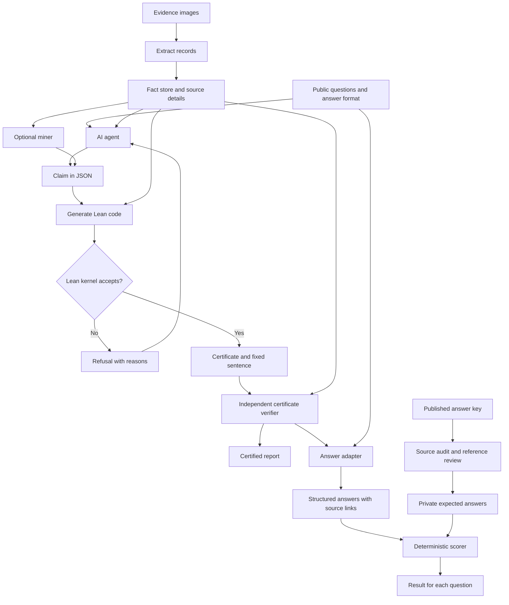

# Chain of Proof

Chain of Proof produces forensic findings with Lean proofs.
The AI investigator searches records and proposes claims.
An optional miner supplies a baseline with preset search rules.
The Lean kernel verifies the formal claim against extracted records.
The report uses fixed sentences from accepted claims.

The project uses the [NIST CFReDS Data Leakage Case](https://cfreds-archive.nist.gov/data_leakage_case/data-leakage-case.html).
The case has 60 questions, one PC image, and three removable media images.
The code also accepts other cases through explicit case profiles and evidence manifests.

## Current state

The full evaluation is in development.
The reference contains all 60 questions.
Of these, 46 have provisional scoring rules and 14 require reference review.
No final comparison with Mulder is available.

The [current run](runs/current/run.json) combines saved AI claims and miner claims.
It uses the current certificate format and sentence templates.
It does not include a new investigation with all current readers.
The saved report fully answers 9 of the 46 provisionally scorable questions.
Another 17 questions have partial answers, and 20 have no answer.
The remaining 14 questions require reference review.
This gives 9 confirmed complete answers across all 60 questions.
See the [current results](runs/current/results.json) for each question.

All 473 certificates in this snapshot pass independent verification.
This count measures certificate validity, not answer accuracy.

The [60-question package](comparison/mulder/README.md) and [original 20-item package](comparison/mulder-original20/README.md) are prepared only.
We will run it after implementation and reference review are complete, with the user's instruction.
Old reports and old scoring methods are available in Git history.

## Pipeline



The public questions go to the investigator.
The expected answers go only to the scorer.
An optional appendix can contain AI judgments.
Those judgments have no Lean certificate.

1. The extractor reads the evidence images.
   It records values, timestamps, uncertainty, and source details.
   It also records parser failures.
2. The fact store assigns each record an identifier.
   It stores text separately from the numeric fields used by Lean.
3. The AI agent searches the fact store through restricted tools.
   The optional miner uses preset rules to produce candidate claims.
4. The checker converts each candidate claim into Lean code.
   The agent cannot supply its own Lean proof.
5. The Lean kernel accepts or rejects the claim for the cited records.
   An accepted claim receives a certificate and a sentence from a fixed template.
6. The independent verifier reads the fact store again.
   It compares copied fields, source details, hashes, sentences, and rule labels.
   It also regenerates the proof and runs the Lean kernel again.
7. The report contains the accepted sentences.
   The answer adapter puts supported values into the public answer format.
   Each value retains its source links.
8. The scorer compares these answers with the private reference.
   It applies declared rules for strings, lists, paths, and timestamps.
   It does not use an LLM judge.

## Proof scope

A Lean proof establishes that a formal claim follows from the supplied records and rule definitions.
It does not establish that a parser read the image correctly.
It does not prove the meaning of arbitrary English.
It does not prove that the answer key is correct.

A false positive is a reported assertion that the evidence does not support.
The project does not claim zero false positives for the complete system.
The certificate verifier and the false-claim tests cover specific failure modes.
Parsers, source interpretation, sentence templates, and answer adapters still require review.

| Component | What it establishes |
|---|---|
| Lean kernel | The formal claim holds for the supplied facts. |
| Certificate verifier | The certificate agrees with the fact store and the current proof rules. |
| Source audit | Source hashes and declared literal text agree with the saved answer document. |
| Answer scorer | Submitted values meet the declared answer contract. |
| Human review | The source interpretation and the evaluation contract are appropriate. |

A certificate can include a heuristic rule.
Its strength label identifies this dependency.
A proof of that rule's conditions does not make the heuristic certain.

## Formal claims

The intermediate representation uses five operations.
Named forensic rules combine these operations.
See the [rule definitions](lean/ChainOfProof/Rules.md) and [Lean theorems](lean/ChainOfProof/Theorems.lean).

| Operation | Meaning |
|---|---|
| `is` | A record has a specified type. |
| `val` | A record field has a specified value. |
| `link` | Two record fields contain the same identifier. |
| `before` | One timestamp precedes another beyond their combined uncertainty. |
| `both` | Both claims hold. |

For example, a USB mount claim must use the same device identifier in both cited records.
A matching display label is insufficient for device identity.
Count claims refer to all matching records in the supplied fact store.
They do not establish that the extractor found every real event.

## Evaluation

A question can require a single value, a table, or several related answers.
Each required table field contributes to that question's result.
Full credit requires all required answers under the declared comparison rules.

| Result | Meaning |
|---|---|
| `FOUND` | All required values match, with no extra values outside the contract. |
| `PARTIAL` | Some required values match. |
| `MISSED` | The system supplies no answer. |
| `INCORRECT` | The system supplies an answer, but no required value matches. |
| `UNEVALUABLE` | The reference cannot yet determine the full result. |

All 60 questions remain visible in the results.
The scorer reports the number of questions with complete answers.
It also reports questions that require reference review.
A difference from the answer contract is not sufficient evidence of a forensic false positive.
For example, a valid additional record can be outside a reference list.

The current case is a development case.
Developers have read its answer key.
A future test on unseen evidence must use a separate frozen reference.
See the [evaluation procedure](eval/EVALUATION.md) and [reference review](eval/BENCHMARK_REFERENCE.md).

## Local setup

Install Python and the Lean toolchain named in [lean-toolchain](lean/lean-toolchain).
The core package requires Python 3.9 or later.
The optional API backend requires Python 3.11 or later.

Create the Python environment:

```sh
python3 -m venv .venv
.venv/bin/python -m pip install -e .
```

Build the Lean project from the `lean` directory:

```sh
cd lean
lake build
```

Return to the repository root.
Run the regression tests:

```sh
.venv/bin/python -m unittest discover -s tests -t .
```

Verify the saved certificates:

```sh
.venv/bin/python -m verifier.verify \
  --run runs/current/run.json --facts evidence/case_facts.json
```

## Data and commands

The image files remain outside Git.
Use [fetch_data.sh](scripts/fetch_data.sh) to download the NIST images.
The `--pc` option includes the PC image.

Install the optional readers before you rebuild facts:

```sh
.venv/bin/python -m pip install -e '.[extract]'
.venv/bin/python -I extractor/build.py data \
  --exhibits extractor/exhibits.json --out runs/dev/rebuilt-facts.json
```

Use a new output directory for each development run.
This command runs the fixed miner and the declared evaluation:

```sh
.venv/bin/python -m eval.baseline \
  --facts evidence/case_facts.json \
  --certs runs/dev/miner/certs --run runs/dev/miner/run.json \
  --questions eval/benchmark_nist_questions.json \
  --reference eval/benchmark_nist.json --adapter nist \
  --out runs/dev/miner/results.json
```

The miner reports record groups that its default size limit excludes.
Use `--complete` to include those groups and supported journal joins.
This option can produce a large number of claims.

The AI investigator uses `python -m agent.run`.
It accepts the same explicit question and reference options.
It supports a Claude Code login or the optional API backend.
A model run can incur API costs.

For another case, supply its public profile, images, and acquisition metadata.
Use its own reference and an answer adapter or structured submission.
The scorer does not require NIST record types.
An unsupported case receives no automatic NIST score.

## Technical terms

| Term | Definition |
|---|---|
| Extractor | A program that reads an image and produces records. |
| Fact | A typed record supplied to the proof system. |
| Claim | A formal assertion about cited facts. |
| Miner | A fixed program that proposes claims. |
| Lean kernel | The part of Lean that verifies proofs. |
| Certificate | A claim, its cited facts, proof details, and generated sentence. |
| Verify | Use the specified software to establish that its checks pass. |
| Answer adapter | A program that converts supported values into the public answer format. |
| Reference | The expected answers and declared comparison rules. |
| Scorer | A program that compares a submission with the reference. |

This document uses ASD-STE100 writing conventions and the technical terms above.
See [ASD-STE100 Issue 9](https://www.asd-ste100.org/assets/files/ASD-STE100_ISSUE9.pdf).
See [TASKS.md](TASKS.md) for the work that remains.
See [WORKSTREAMS.md](WORKSTREAMS.md) for task ownership and the terminal handoff.
