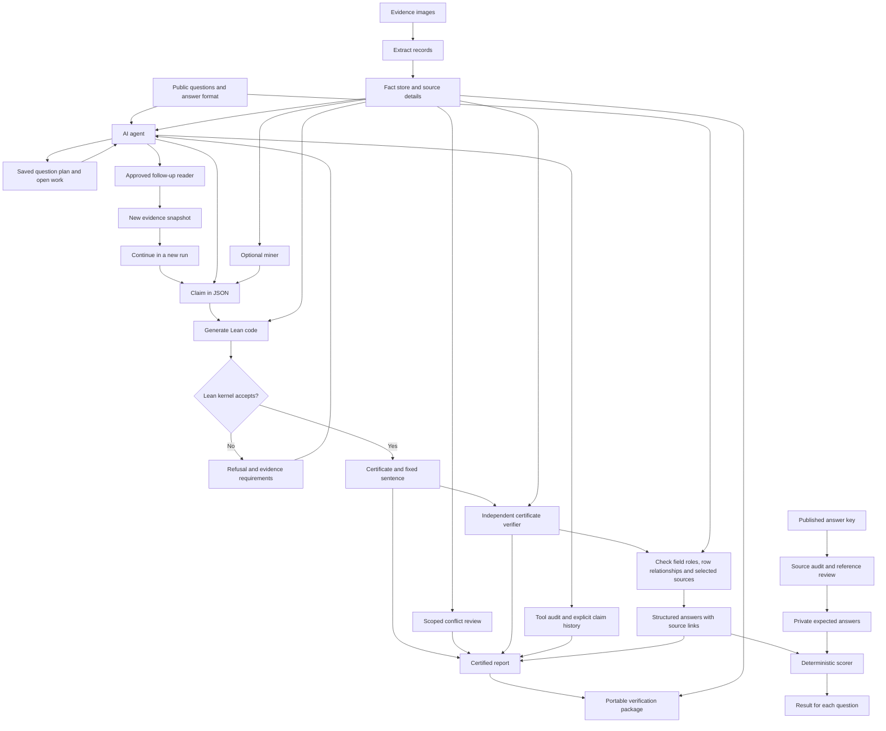

# CONAN-F

**Machine-checked digital forensics: the AI proposes, Lean 4 decides.**

CONAN-F (*CONsistent ANalysis in Forensics*) is an AI forensic investigator.
The agent searches evidence and proposes claims. A deterministic checker converts
supported claims to Lean code. The Lean 4 kernel checks them against extracted records.
Accepted findings use fixed sentences and carry independent verification certificates.
The report keeps examiner judgments and unresolved questions separate.

A certificate establishes the declared formal claim for the cited records and rules.
It does not establish parser correctness, complete answers, or real-world attribution.

---

## Why this matters

Digital forensic evidence ends up in court, but LLM investigators hallucinate: they
invent device connections, misread timestamps, and state conclusions the data does not
support. CONAN-F separates **what the AI claims** from **what is proven**:

- The agent has no way to write its own proof. It can only propose a claim.
- A deterministic checker turns the claim into Lean code and runs the kernel.
- Accepted claims get a certificate; a second, independent verifier re-derives the
  proof from the raw facts to confirm it.
- Each certified finding links to its records and proof. Judgments carry a separate label.

The result is a forensic report where each finding carries a portable, re-verifiable
proof — not an AI's assurance.

## What it does

- **AI investigator** — an agent searches an immutable fact store through restricted
  tools (no shell, no filesystem) and proposes claims to answer your questions.
- **Lean-checked findings** — a formal kernel accepts or rejects each claim for the
  exact records cited. Refusals come with the evidence still required.
- **Independent verifier** — re-reads the facts and regenerates every proof. A second
  checker (con-leche, bundled with Lean 4.35) gives a separate opinion on the proofs.
- **Examiner reports** — HTML/Markdown/PDF reports and a visual **proof graph** that
  traces each finding from disk image → artifact → record → Lean proof.
- **Workbench** — a browser or native desktop app to run investigations, inspect tool
  calls, and build an examiner's report.
- **Portable verification packages** — bundle the report, facts, certificates, and logs
  so a third party can re-verify everything offline.

The project includes two official NIST cases:

| Case | Public questions | Evidence |
|---|---:|---|
| [Data Leakage](https://cfreds-archive.nist.gov/data_leakage_case/data-leakage-case.html) | [60](eval/QUESTIONS.md) | One PC and three removable media images |
| [Hacking Case](https://cfreds-archive.nist.gov/Hacking_Case.html) | [31](eval/hacking_case/questions.json) | One Windows XP image in two E01 segments |

The [Hacking Case guide](docs/HACKING_CASE.md) gives its commands and limits.
Its public questions and private reference stay separate. It has readers for older
application settings, captured traffic, browser files, accounts, and deleted records.
Dataset support does not mean that every answer is correct or every conclusion can be proved.
Use the public readiness check to inspect unsupported meanings and missing role records.
Other cases use explicit case profiles and evidence manifests.

The [current source support](docs/SYSTEM_EVIDENCE_COVERAGE.md) adds scoped account,
network, timezone, partition, event, Search, cloud, document and mail fields.
Related answer fields must use one source subject and the required source view.
Lean checks typed fields and exact declared file sets. A larger set of records
does not prove a stronger conclusion. Unsupported meanings stay explicit.

Paged tools and saved answer checkpoints retain partial work. The next comparison
remains held until the integrated code, fresh evidence and compatible reference
bundle pass review. Reader checks and proof checks are not new accuracy results.
The [work log](WORKSTREAMS.md) records current ownership and validation.

## Try it in 60 seconds

```sh
python3 -m venv .venv
.venv/bin/python -m pip install --upgrade pip
.venv/bin/python -m pip install -e .          # installs the `cop` command

# run an investigation over extracted facts
cop investigate --name dev/my-case --facts /path/facts.json \
  --title "Removable media review" \
  --question "Which removable devices were connected?" \
  --question "Which files were opened from those devices?" \
  --backend claude-code --model opus --minutes 10

# render and independently re-verify the result
cop report --run runs/dev/my-case/run.json --format html --out report.html
cop verify --run runs/dev/my-case/run.json --facts /path/facts.json
```

Use `python -m app.cli` if the `cop` command is not on your PATH. Each run saves
`report.html`, `report.md`, and `run.json` in its run directory. Press Ctrl+C to stop
and keep partial work. The `claude-code` backend uses your local Claude Code login (no
API key); `--backend deepagents` uses the Anthropic API (`ANTHROPIC_API_KEY`).

Prefer a GUI? Launch the workbench:

```sh
cop serve        # local browser app on 127.0.0.1
cop desktop      # same app in a native window (needs `.[desktop]`)
```

## Results so far

The [latest Data Leakage repeat](comparison/ablation/RESULTS_SOL61_POSTFIX_20261115.md)
used the same 335,509 extracted records and all 60
public questions. Each investigator had a 15-minute limit. Fixed rules score the
saved answers; there is no LLM judge.

| Mode | Complete | Partial | Unanswered | Incorrect |
|---|---:|---:|---:|---:|
| A — no Lean feedback | 7/46 | 22 | 16 | 1 |
| B — check A's exact claims afterward | 7/46 | 22 | 16 | 1 |
| C — Lean feedback during investigation | Unavailable | Unavailable | Unavailable | Unavailable |

The reference has 46 scorable questions and 14 unresolved questions. All 60 remain
in the result. A and B matched 544 of 1,627 scorable answer fields (33.4%). They also
submitted 2,644 extra assertions and 99 unequal values. These are answer-contract
mismatches, not counts of forensic false positives.

C reached the time limit before it saved its final answer bindings. Its answer
accuracy is unavailable. It retained 1,017 certified claims, and all 1,017 passed
independent replay. B retained 84 of A's 87 candidates; three had malformed syntax.
All 84 B certificates passed replay. Removing those candidates did not change A's
answers. **A certificate count is not an answer-accuracy score.**

The repeat is frozen at `96cd518`. It cannot establish an A-versus-C accuracy result.
The [earlier completed comparison](comparison/ablation/RESULTS_SOL61_20261115.md)
showed no overall accuracy gain from Lean feedback. Its three incorrect C answers
were narrow observations placed in stronger answer fields. See [the diagnosis](docs/INCORRECT_ANSWER_DEBUG.md).

A [separate three-question diagnostic](comparison/ablation/RESULTS_MEANING_DIAGNOSTIC_20261115.md)
completed with 21 independently verified
claims. It preserved narrow observations and left stronger unsupported fields empty.
The agent submitted no incompatible bindings, so this run does not demonstrate the
guard catching an error. It has no accuracy key or accuracy score.

The [Hacking Case mechanical workflow](docs/HACKING_CASE_VALIDATION.md)
extracted 11,939 records and produced reports
and a portable package. All 58 selected certificates passed replay and con-leche.
This checks the workflow; it is not the 31-question model test. Stronger attribution,
subscription state and the partial antivirus scan remain explicit limits.
The earlier DFIR Madness operational test is a separate case with no accuracy key.
The full A/B/C/D comparison and native-provider validation remain unfinished.

## How it works



Public questions go to the investigator; expected answers go only to the scorer.

1. **Extract** — the extractor reads evidence images into records with values,
   timestamps, uncertainty, source details, and any parser failures.
2. **Store** — the fact store assigns each record an ID and keeps text separate from the
   numeric fields Lean reasons over.
3. **Investigate** — the AI agent searches the store through restricted tools. An
   optional miner proposes candidate claims from preset rules.
4. **Check** — the checker converts each claim to Lean code (the agent cannot supply its
   own proof) and the kernel accepts or rejects it for the cited records. Accepted
   claims get a certificate and a sentence from a fixed template.
5. **Re-verify** — an independent verifier re-reads the facts, compares every copied
   field/hash/sentence, regenerates the proof, and runs the kernel again.
6. **Report** — accepted findings use fixed sentences. Examiner judgments stay separate.
   Explicit bindings place claim values into the public answer format with source links.
   The product rejects answer fields without a declared role, or with an incompatible
   role. Related fields must come from the same atomic claim, or a declared checked
   relation. Independent fields need an explicit policy. Narrow source observations
   remain available. This does not prove the complete answer.
7. **Score** — a deterministic scorer compares answers to the private reference using
   declared rules for strings, lists, paths, and timestamps.

## What a proof does and does not establish

A Lean proof establishes that a **formal claim follows from the supplied records and
rule definitions**. It does *not* prove the parser read the image correctly, the meaning
of arbitrary English, or that the answer key is right.

The readers produce ordinary typed data, not new Lean axioms. The checker places the
cited records and the proposed claim in a Lean file. Lean proves that the defined
claim-checking function returns `true` for those records. The agent can select records
and propose supported claims. It cannot add an assumption or change a proof rule.

| Component | What it establishes |
|---|---|
| Lean kernel | The formal claim holds for the supplied facts. |
| Certificate verifier | The certificate agrees with the fact store and current proof rules. |
| Source audit | Source hashes and declared literal text agree with the saved answer document. |
| Answer scorer | Submitted values meet the declared answer contract. |
| Human review | The source interpretation and the evaluation contract are appropriate. |

CONAN-F does **not** claim zero false positives for the complete system. Parsers, source
interpretation, sentence templates, and answer adapters still require human review. Some
certificates carry a heuristic rule, marked with a strength label — proving its
conditions does not make the heuristic certain.

The formal layer uses five primitive operations that named forensic rules combine. See
the [rule definitions](lean/ChainOfProof/Rules.md) and [Lean theorems](lean/ChainOfProof/Theorems.lean).

| Operation | Meaning |
|---|---|
| `is` | A record has a specified type. |
| `val` | A record field has a specified value. |
| `link` | Two record fields contain the same identifier. |
| `before` | One timestamp precedes another beyond their combined uncertainty. |
| `both` | Both claims hold. |

For example, a USB mount claim must use the *same device identifier* in both cited
records — a matching display label is not enough for device identity.

## Working with evidence and new cases

Give each new case an explicit image manifest, e.g. `exhibits.json`:

```json
{"laptop.E01": {"exhibit": "PC1", "role": "pc"}}
```

Supported roles are `pc`, `removable`, and `optical`. Intake accepts E01–E99 sets, raw
`.dd`/`.raw`/`.img`/`.bin`, and `.iso`/`.udf` images. A recognized extension does not
guarantee every file system or artifact is supported; parser failures are kept in the
extraction health file.

```sh
# investigate straight from images
cop investigate --name dev/new-case --images /path/images --exhibits exhibits.json \
  --question "Which external devices were connected?" --minutes 10

# or just extract facts, no AI run
cop ingest --images /path/images --exhibits exhibits.json --out /path/new-snapshot
```

Images are read locally; the investigator backend receives only the public prompt and
selected tool results. Each snapshot records its image hashes, facts hash, reader
selection, and parser failures.

**Continuations** create a new run without changing the previous report:

```sh
cop plan --run runs/dev/new-case
cop resume --run runs/dev/new-case --name dev/new-case-2 --minutes 10 \
  --question "What evidence links those devices to the opened files?"
```

With identical facts, a resume re-checks prior accepted claims and restores question
links. With new facts, pass `--facts /path/new-snapshot/facts.json`. The `collect` tool
can run an approved reader that has not yet run, writing a new snapshot while retaining
the current one (one collection per run; `--follow-up-stages 1` continues automatically).

The final report also includes a review of recognized identity ambiguities and scoped
record conflicts — it preserves timestamp uncertainty and does not pick which source is
true. A clean review does not establish that all evidence is consistent.

## The workbench

The same runner powers a browser app (`cop serve`) and a native desktop window
(`cop desktop`). The desktop window uses the operating system's own web view, so no
browser engine is bundled; the front end is plain HTML/CSS/JS with no framework and no
graph library.

```sh
.venv/bin/python -m pip install -e '.[desktop]'    # once: adds pywebview and the `conan` command
conan                                              # the same as `cop desktop`
python -m app.desktop --make-app ~/Applications    # macOS: a double-clickable Conan.app
```

The desktop application is called Conan. Its mark is original artwork in
`app/static/icon.svg`; `python scripts/make_icon.py` rebuilds the macOS icon from it.

It opens on two everyday views, with the detail views beside them:

- **Summary** — the case at a glance: findings that passed and were refused, source
  timestamps, evidence types, exhibits, and selected records for each day.
  It counts and draws the stored run; it adds no finding of its own.
- **Timeline** — records with a stated source timestamp that an accepted finding cites, on a UTC
  axis with one row per kind of activity. Drag to move, scroll to zoom, click a mark for
  the record, its source and the findings that use it. Key events are picked by record
  type (a device connection, an e-mail, a deletion), never by a model's judgment.
  Examination times and unknown time meanings stay off the event axis. A source
  timestamp does not by itself prove when a user acted.
- **Proof graph** — draws each finding back to its source (disk image → artifact →
  record → Lean-checked finding → any uncertified interpretation). Select a node to
  trace lineage, double-click a finding to see those sharing its records, and replay in
  audit-log order through every finding. Draws 40 findings at a time; filter by device,
  file, path, or ID.
- **Findings**, **Not established**, **Activity**, **Coverage** — the same run as tables.
- **Report** — mark findings, choose sections/appendices, add a case reference and
  examiner, then print or save as PDF. A marked-findings report states on page one that
  it is a selection and what it omits.

The inspector shows each item's records, provenance, and Lean proof. Export downloads the
full report as HTML/Markdown or the run bundle as JSON.

## Portable verification packages

Bundle a report, its complete fact store, certificates, and logs so anyone can
re-verify offline:

```sh
.venv/bin/python -m verifier.package build \
  --run runs/dev/my-case/run.json --facts /path/facts.json \
  --out /path/new-verification-package
.venv/bin/python -m verifier.package verify --bundle /path/new-verification-package
```

The verifier checks file hashes and regenerates proofs from the copied facts. The
original disk images and private answer key are not included.

## Local setup (full)

Install Python and the Lean toolchain named in [lean-toolchain](lean/lean-toolchain).
The core package needs Python 3.9+; the optional API backend needs 3.11+.

```sh
python3 -m venv .venv
.venv/bin/python -m pip install --upgrade pip   # macOS system pip is too old otherwise
.venv/bin/python -m pip install -e .

cd lean && lake build && cd ..                  # build the Lean project
```

Run the regression suite (needs the Dissect readers; `.[agent]` adds the API graph tests):

```sh
.venv/bin/python -m pip install 'dissect>=3.20'
.venv/bin/python -m unittest discover -s tests -t .
```

Verify the saved certificates, then recheck with the second proof checker:

```sh
.venv/bin/python -m verifier.verify \
  --run runs/dev/my-case/run.json --facts /path/facts.json
.venv/bin/python -m verifier.conleche --run runs/dev/my-case/run.json
```

con-leche is written separately from Lean's own kernel. Its result concerns the saved
proofs. It does not check whether the readers parsed the images correctly.

### Rebuilding facts from the disk images

Image files stay outside Git. Use [fetch_data.sh](scripts/fetch_data.sh) to download the
Data Leakage images (`--pc` includes the PC image), then:

```sh
.venv/bin/python -m pip install -e '.[extract]'
.venv/bin/python -I extractor/build.py data \
  --exhibits extractor/exhibits.json --out runs/dev/rebuilt-facts.json
```

For the other NIST dataset, use [fetch_hacking_case.py](scripts/fetch_hacking_case.py)
and the [Hacking Case commands](docs/HACKING_CASE.md). Image hash verification and the
local antivirus reader require explicit selection. Scanner timeouts retain partial results.

The fixed miner plus the declared evaluation:

```sh
.venv/bin/python -m eval.baseline \
  --facts evidence/case_facts.json \
  --certs runs/dev/miner/certs --run runs/dev/miner/run.json \
  --questions eval/benchmark_nist_questions.json \
  --reference eval/benchmark_nist.json --adapter nist \
  --out runs/dev/miner/results.json
```

For another case, supply its public profile, images, and acquisition metadata, plus its
own reference and an answer adapter. The scorer does not require NIST record types.

## Evaluation

Each required answer field contributes to a question's result; full credit needs all
required answers under the declared comparison rules.

| Result | Meaning |
|---|---|
| `FOUND` | All required values match, no extra values outside the contract. |
| `PARTIAL` | Some required values match. |
| `MISSED` | The system supplies no answer. |
| `INCORRECT` | The system supplies an answer, but no required value matches. |
| `UNEVALUABLE` | The reference cannot yet determine the full result. |

All 60 questions stay visible in the results. A difference from the answer contract is
*not* sufficient evidence of a forensic false positive (e.g. a valid extra record can be
outside a reference list). Data Leakage is a development case: earlier work used its published key.
For Hacking Case, a separate reference author read the key; reader and proof builders
used public questions and evidence. Neither case is a new secret benchmark.
A future unseen-case test needs an independently frozen reference. See the [evaluation procedure](eval/EVALUATION.md) and
[reference review](eval/BENCHMARK_REFERENCE.md).

## Glossary

| Term | Definition |
|---|---|
| Extractor | A program that reads an image and produces records. |
| Fact | A typed record supplied to the proof system. |
| Claim | A formal assertion about cited facts. |
| Miner | A fixed program that proposes claims. |
| Lean kernel | The part of Lean that verifies proofs. |
| Certificate | A claim, its cited facts, proof details, and generated sentence. |
| Verify | Use the specified software to establish that its checks pass. |
| Answer adapter | A program that converts supported values into the public answer format. |
| Reference | The expected answers and declared comparison rules. |
| Scorer | A program that compares a submission with the reference. |

---

This document uses short instructions and the glossary above, following the requested
Simplified Technical English style. Formal ASD-STE100 compliance has not been audited. See [TASKS.md](TASKS.md) for remaining work
and [WORKSTREAMS.md](WORKSTREAMS.md) for task ownership.
